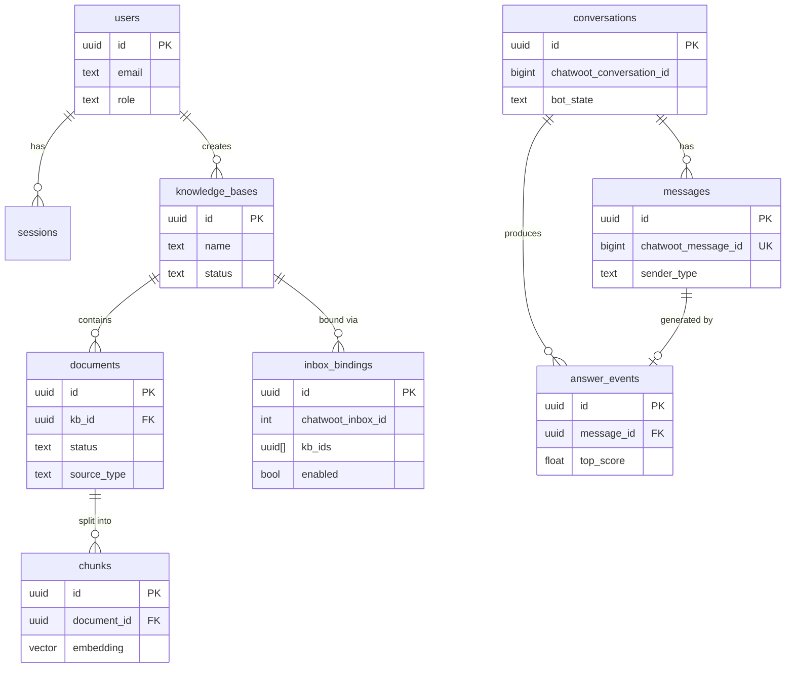

# Data Model

All state lives in one Postgres database ([ADR-0002](../decisions/0002-postgres-pgvector.md)). Schema changes are migrations only. Table names are `snake_case`, ids are UUIDs (except Chatwoot ids, which are integers and kept as `*_chatwoot_id`).

## Entity overview



## Tables

### `users` (owner: `auth` / `users`)

| Column | Type | Notes |
| --- | --- | --- |
| `id` | uuid PK | |
| `email` | citext UNIQUE | login |
| `password_hash` | text | argon2id |
| `name` | text | |
| `role` | text | `admin \| editor \| viewer` |
| `is_active` | bool | soft disable |
| `created_at`, `updated_at` | timestamptz | |

### `sessions` (owner: `auth`)

| Column | Type | Notes |
| --- | --- | --- |
| `id` | uuid PK | session id stored in cookie (httpOnly) |
| `user_id` | uuid FK → users | |
| `expires_at` | timestamptz | sliding, 7 days default |
| `created_at` | timestamptz | |
| `user_agent`, `ip` | text | audit only |

### `knowledge_bases` (owner: `knowledge-base`)

| Column | Type | Notes |
| --- | --- | --- |
| `id` | uuid PK | |
| `name` | text | e.g. "Billing FAQ" |
| `description` | text | |
| `status` | text | `active \| archived` |
| `created_by` | uuid FK → users | |
| `created_at`, `updated_at` | timestamptz | |

### `documents` (owner: `knowledge-base`)

| Column | Type | Notes |
| --- | --- | --- |
| `id` | uuid PK | |
| `kb_id` | uuid FK → knowledge_bases | cascade delete |
| `source_type` | text | `upload \| url \| text` |
| `filename` | text | original name |
| `mime_type`, `size_bytes` | text / int | |
| `storage_path` | text NULL | path on uploads volume (nullable for `text`) |
| `status` | text | `processing \| ready \| failed` |
| `error` | text NULL | failure reason, shown in UI |
| `chunk_count` | int | denormalized for the UI |
| `content_hash` | text | sha256 of raw content — skip re-embedding if unchanged |
| `created_by` | uuid FK → users | |
| `created_at`, `updated_at` | timestamptz | |

### `chunks` (owner: `ingestion` writes, `retrieval` reads)

| Column | Type | Notes |
| --- | --- | --- |
| `id` | uuid PK | |
| `kb_id` | uuid FK | denormalized for filtered search (avoid join per query) |
| `document_id` | uuid FK → documents | cascade delete |
| `content` | text | the chunk text that is embedded and fed to the model |
| `token_count` | int | |
| `embedding` | vector(1536) | **dimension fixed at migration time** (D3) — see below |
| `chunk_index` | int | order within document |
| `metadata` | jsonb | `{ heading, page, source_url }` when available |
| `created_at` | timestamptz | |

Indexes:

```sql
CREATE EXTENSION IF NOT EXISTS vector;

CREATE INDEX chunks_embedding_hnsw
  ON chunks USING hnsw (embedding vector_cosine_ops)
  WITH (m = 16, ef_construction = 64);

CREATE INDEX chunks_kb_id_idx ON chunks (kb_id);
```

Search uses cosine distance: `ORDER BY embedding <=> $1 LIMIT k`. Similarity = `1 - distance`; the threshold in settings is expressed as similarity.

> **Dimension lock-in (D3):** `vector(N)` is configured once per deployment in a migration. Changing the embedding model later = new column + full re-embed (planned runbook in [deployment](../operations/deployment.md)).

### `inbox_bindings` (owner: `bindings`)

| Column | Type | Notes |
| --- | --- | --- |
| `id` | uuid PK | |
| `chatwoot_account_id` | int | usually one account; kept for safety |
| `chatwoot_inbox_id` | int UNIQUE | |
| `kb_ids` | uuid[] | KBs served for this inbox (empty = bot effectively off here) |
| `enabled` | bool | per-inbox kill switch |
| `display_name` | text | inbox name cached from Chatwoot for the UI |
| `created_at`, `updated_at` | timestamptz | |

### `conversations` (owner: `conversations`)

| Column | Type | Notes |
| --- | --- | --- |
| `id` | uuid PK | |
| `chatwoot_account_id` | int | |
| `chatwoot_conversation_id` | bigint | UNIQUE with account |
| `chatwoot_inbox_id` | int | which inbox/channel |
| `contact_chatwoot_id` | bigint | |
| `contact_name` | text | cached for UI |
| `bot_state` | text | `active \| paused \| handed_off` — our view of "may the bot reply" |
| `last_message_at` | timestamptz | |
| `created_at`, `updated_at` | timestamptz | |

### `messages` (owner: `conversations`)

| Column | Type | Notes |
| --- | --- | --- |
| `id` | uuid PK | |
| `conversation_id` | uuid FK | |
| `chatwoot_message_id` | bigint UNIQUE | idempotency key for webhook dedupe |
| `direction` | text | `incoming \| outgoing` |
| `sender_type` | text | `contact \| bot \| human_agent \| system` |
| `content` | text | stored as-is (private notes included) |
| `is_private` | bool | Chatwoot private note |
| `created_at` | timestamptz | |

### `answer_events` (owner: `analytics`)

One row per bot answer attempt — the analytics and debugging backbone.

| Column | Type | Notes |
| --- | --- | --- |
| `id` | uuid PK | |
| `conversation_id` | uuid FK | |
| `incoming_message_id` | uuid FK → messages | the question |
| `outgoing_message_id` | uuid FK → messages NULL | the answer, when posted |
| `outcome` | text | `answered \| escalated_low_score \| escalated_request \| escalated_classifier \| escalated_repeat \| error` |
| `query_text` | text | the actual retrieval query (after rewrite) |
| `top_k` | int, `top_score` | float | best similarity seen |
| `retrieved_chunk_ids` | uuid[] | |
| `embedding_ms`, `retrieval_ms`, `generation_ms`, `total_ms` | int | latency breakdown |
| `embedding_model`, `chat_model` | text | which models produced this |
| `tokens_in`, `tokens_out` | int | chat model usage |
| `estimated_cost_usd` | numeric(10,6) | |
| `created_at` | timestamptz | |

### `settings` (owner: `settings`)

Single-row-style table (key/value) with typed accessors; values are validated on write.

| Key | Default | Meaning |
| --- | --- | --- |
| `bot_enabled` | `false` | global kill switch |
| `system_prompt` | (file default) | persona + grounding rules template |
| `fallback_message` | "I'm not sure about that — let me get a human colleague for you." | customer-facing escalation text |
| `retrieval_top_k` | `10` | candidates |
| `retrieval_score_threshold` | `0.35` | min similarity to answer (tune with evals) |
| `context_chunks` | `5` | chunks placed into the prompt |
| `max_reply_chars` | `800` | hard cap before posting |
| `embedding_model`, `chat_model` | env defaults | model ids |

> Secrets (API keys, Chatwoot tokens) are **never** in this table — environment only ([security](../operations/security.md)).

### `audit_logs` (owner: `analytics`)

`id, user_id, action (text), entity (text), entity_id (text), data jsonb, created_at` — written for logins, KB/document changes, binding/settings changes.

## Conventions

- **Soft vs hard delete:** documents hard-delete (and cascade chunks); KBs archive by default, hard delete only when empty or via admin confirm; users deactivate, never delete.
- **Timestamps:** always `timestamptz`, UTC.
- **IDs exposed to Chatwoot vs ours:** never mix — our API returns our UUIDs; Chatwoot ids only appear in integration code and admin views.
- **Queue & cache live in Redis** ([ADR-0006](../decisions/0006-job-queue.md)): BullMQ keys and cache entries are never a source of truth — durable state is only in Postgres. Do not store anything in Redis you can't rebuild.
- **Migrations:** forward-only, committed in `apps/api/src/db/migrations`, run at deploy (see [deployment](../operations/deployment.md)).
