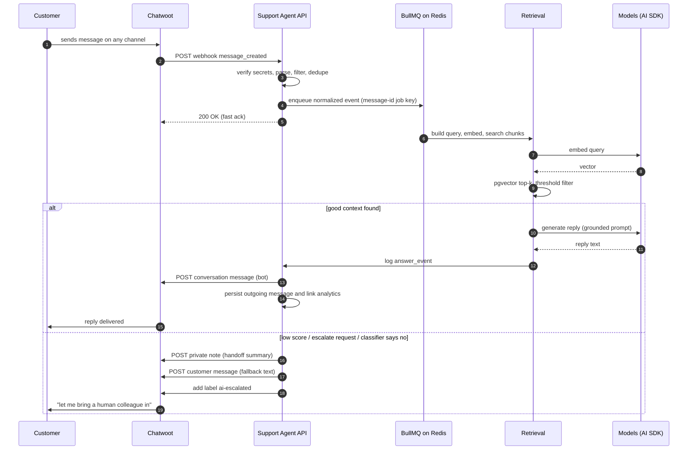

# Message Flow

The lifecycle of one customer conversation, from webhook to reply. This is the highest-traffic path in the system — everything here must be idempotent, ordered, and boring.

> **Status (2026-10):** webhook intake and the queued reply path are implemented.
> This document describes the current behavior; captured fixtures, worker tests,
> and live-version validation remain ([Chatwoot status](../integrations/chatwoot.md#status-and-scope)).

## Happy path



## Step by step (webhook side)

1. **Receive** `POST /api/webhooks/chatwoot/:secret` ([contract](../integrations/chatwoot.md)). Verify the URL secret and configured HMAC, parse the payload, enqueue a normalized event, then answer 200. If enqueueing fails (for example, Redis is unavailable), answer 500 so Chatwoot can retry.
2. **Filter** message events: only incoming, non-private messages from contacts in the configured account continue. Unsupported events are acknowledged and ignored. The worker checks inbox binding/KBs, the global `bot_enabled` setting, human assignment, `ai-paused`/`ai-escalated`, and local conversation state.
3. **Dedupe**: Postgres enforces unique `chatwoot_message_id`; webhook jobs for a message use an account/message id key. Existing completed answer events with a linked outgoing message suppress another reply.
4. **Persist** an accepted incoming message and upsert its conversation in the worker.
5. **Serialize** with a per-conversation Redis lock (`SET NX PX`, renewed). Message jobs are keyed per Chatwoot message, not coalesced by conversation. A worker skips a queued message when a later incoming message is already in stored history.

## Step by step (job side)

6. **Load context**: last N (default 8) messages of the conversation from our DB, KBs bound to the inbox (via `bindings`).
7. **Retrieve**: build the standalone question (incl. recent customer turns when the message is referential), embed, pgvector search, threshold filter ([RAG pipeline](rag-pipeline.md)).
8. **Decide** using the current retrieval score and output guard. The worker separately detects common explicit requests for a human. There is no model classifier for escalation intent or repeat-question detection yet.
9. **Decide**:
   - can answer and score OK → **generate reply** (grounded prompt) → post via Chatwoot API → log `answer_events (outcome=answered)`.
   - otherwise → **escalation flow** (below).
10. **Guard**: cap reply length, strip URLs we didn't put in KB content, ensure non-empty. Failure → escalation flow.
11. **Post**: `POST /conversations/:id/messages` with the Agent Bot token ([Chatwoot doc](../integrations/chatwoot.md)). Save the returned outgoing message id and attach it to the answer event. A crash after Chatwoot accepts a send but before Postgres saves it is a small non-atomic window; a retry can duplicate that reply.
12. **Log** the `answer_events` row with model/retrieval/latency/token data; analytics writes are best effort.

## Escalation flow

Triggers (evaluated in step 8/9; from [requirements FR-6](../product/requirements.md)):

| Trigger | outcome value |
| --- | --- |
| Nothing above score threshold | `escalated_low_score` |
| Reply fails the output guard (length/leak) | `escalated_guard` |
| Customer asks for a human | `escalated_request` |
| Classifier: cannot answer from chunks | `escalated_classifier` |
| Same question repeated after a bot answer | Not implemented yet |
| Any pipeline error after retries | BullMQ job remains failed for inspection; no automatic customer reply |

Actions, in order:

1. Post a **private note** for the human agents:

   ```
   🤖 Escalated: low retrieval score (best 0.21 < 0.35)
   Intent: refund policy for annual plan
   Tried: retrieval over [Billing FAQ]; no confident match
   Top candidates: "Refund policy — monthly" (0.21), "Cancellation" (0.18)
   ```

2. Post the customer-facing fallback message (setting `fallback_message`).
3. Add label `ai-escalated` and set `conversations.bot_state=handed_off`.

From then on the bot stays silent in that conversation until a human (or the dashboard) resumes it.

## Pause / resume rules

| Action | Effect |
| --- | --- |
| Human assignee set in Chatwoot | `bot_state=handed_off` when a `conversation_updated` event reports the assignee |
| Label `ai-paused` added in Chatwoot | `bot_state=paused` (explicit override) |
| Label removed / dashboard "Resume bot" | `bot_state=active`, bot may answer the *next* incoming message (never replays old ones) |
| Human reply without an assignee | Not detected by the current incoming-only message path; set an assignee or `ai-paused` to stop the bot |
| Inbox binding disabled | Bot never starts; conversations keep last state (harmless) |
| Global `bot_enabled=false` | New messages ignored everywhere; running jobs finish (they already started answering a real person — aborting mid-way is worse) |

## Error handling & retries

| Failure | Behavior |
| --- | --- |
| Webhook processing error before 200 | Chatwoot receives an error and may retry; enqueue errors are counted by the webhook 5xx metric |
| Job crash mid-run | BullMQ retries (attempts: 3, exponential backoff); completed message rows and linked answer events suppress common duplicate paths |
| Chat model / embedding API error | BullMQ retries the job; after retry exhaustion it remains failed for operator inspection |
| Chatwoot API error when posting | BullMQ retries; if retries fail, the job stays failed and no customer-facing fallback is guaranteed |
| Redis down | New jobs cannot be enqueued → webhooks answer 500, Chatwoot retries. Running jobs fail and retry after recovery. Dashboard reads unaffected (Postgres). Alert fires — [runbook](../operations/deployment.md#redis-down-or-full) |
| Everything down during the run | Customer gets nothing from us; conversation stays "unanswered" in Chatwoot → normal human queues apply. Alert fires. |

## Out of hours & concurrency notes

- The bot works 24/7 — that is a core benefit (G2). Escalated conversations simply wait for the human schedule; the fallback text does not promise immediate action.
- Concurrency: bounded by the BullMQ worker pool (4) and the per-conversation Redis lock. One lock serializes replies; each incoming message has its own job. If a later message is already stored, the older queued message is skipped.
