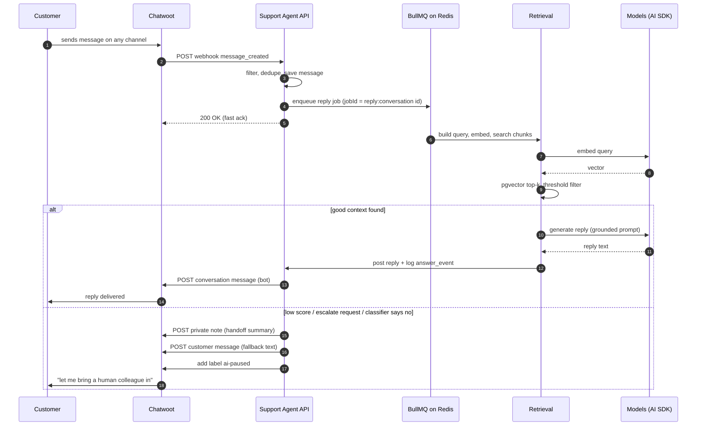

# Message Flow

The lifecycle of one customer conversation, from webhook to reply. This is the highest-traffic path in the system — everything here must be idempotent, ordered, and boring.

> **Status (2026-10):** this is the target contract. Today the webhook is a stub
> that verifies the path secret and answers `501 not_implemented` — steps 1–5
> land with T-201+ ([chatwoot doc § Current status](../integrations/chatwoot.md#current-status-2026-10)).

## Happy path



## Step by step (webhook side)

1. **Receive** `POST /api/webhooks/chatwoot/:secret` ([contract](../integrations/chatwoot.md)). Verify path secret, parse payload with zod, persist, enqueue, then **answer 200** — all sub-second. If the enqueue itself fails (Redis unavailable), answer **500** (Chatwoot's retryable status) so the message is redelivered instead of lost.
2. **Filter** (any match → stop, log at debug level):
   - event is not `message_created` (MVP);
   - `message_type` is not `incoming`;
   - message is private, or `sender.type` is not `contact` (bot's own replies, template, etc.);
   - inbox has no binding or binding disabled (`inbox_bindings.enabled=false`);
   - global `bot_enabled=false`;
   - conversation is assigned to a human, or has label `ai-paused`, or `conversations.bot_state != active`;
   - `non-text` message (P1: escalate instead of ignoring, D8).
3. **Dedupe**: `INSERT ... ON CONFLICT (chatwoot_message_id) DO NOTHING`. Chatwoot may retry deliveries; the same message must never produce two replies.
4. **Persist** the message, upsert the conversation, set `last_message_at`.
5. **Enqueue** the reply job with a deterministic `jobId = reply:<conversation_id>`. If a job for that conversation is already waiting or active, no second job is added — the running worker re-reads the conversation before finishing and picks up newer messages (coalescing). While processing, the worker holds a per-conversation Redis lock (`SET NX PX`, renewed), so **at most one reply job processes per conversation at a time**; if messages arrived meanwhile, the worker re-enqueues itself.

## Step by step (job side)

6. **Load context**: last N (default 8) messages of the conversation from our DB, KBs bound to the inbox (via `bindings`).
7. **Retrieve**: build the standalone question (incl. recent customer turns when the message is referential), embed, pgvector search, threshold filter ([RAG pipeline](rag-pipeline.md)).
8. **Classify** (one structured call, `generateObject`): `can_answer` (given chunks + question), `escalate_reason` (customer requested human / out of scope / unclear), `intent`, plus a repeat-question check against previous bot answers in this conversation.
9. **Decide**:
   - can answer and score OK → **generate reply** (grounded prompt) → post via Chatwoot API → log `answer_events (outcome=answered)`.
   - otherwise → **escalation flow** (below).
10. **Guard**: cap reply length, strip URLs we didn't put in KB content, ensure non-empty. Failure → escalation flow.
11. **Post**: `POST /conversations/:id/messages` with the bot token ([Chatwoot doc](../integrations/chatwoot.md)). Save the outgoing message (idempotency: if our post succeeded but we crashed before saving, Chatwoot retry of the *webhook* cannot duplicate — the reply job is keyed and marked done; a double-send guard compares the last bot message with the new one).
12. **Log** the `answer_events` row (also on failures — outcome tells the story).

## Escalation flow

Triggers (evaluated in step 8/9; from [requirements FR-6](../product/requirements.md)):

| Trigger | outcome value |
| --- | --- |
| Nothing above score threshold | `escalated_low_score` |
| Reply fails the output guard (length/leak) | `escalated_guard` |
| Customer asks for a human | `escalated_request` |
| Classifier: cannot answer from chunks | `escalated_classifier` |
| Same question repeated after a bot answer | `escalated_repeat` |
| Any pipeline error after retries | `error` |

Actions, in order:

1. Post a **private note** for the human agents:

   ```
   🤖 Escalated: low retrieval score (best 0.21 < 0.35)
   Intent: refund policy for annual plan
   Tried: retrieval over [Billing FAQ]; no confident match
   Top candidates: "Refund policy — monthly" (0.21), "Cancellation" (0.18)
   ```

2. Post the customer-facing fallback message (setting `fallback_message`).
3. Add label `ai-paused` and set `conversations.bot_state=handed_off`.

From then on the bot stays silent in that conversation until a human (or the dashboard) resumes it.

## Pause / resume rules

| Action | Effect |
| --- | --- |
| Human replies in the conversation | `bot_state=paused` (implicit takeover — assignment webhook, P1; MVP: label check + "any human message" check in the worker) |
| Label `ai-paused` added in Chatwoot | `bot_state=paused` (explicit override) |
| Label removed / dashboard "Resume bot" | `bot_state=active`, bot may answer the *next* incoming message (never replays old ones) |
| Inbox binding disabled | Bot never starts; conversations keep last state (harmless) |
| Global `bot_enabled=false` | New messages ignored everywhere; running jobs finish (they already started answering a real person — aborting mid-way is worse) |

## Error handling & retries

| Failure | Behavior |
| --- | --- |
| Webhook processing error before 200 | Chatwoot retries; our handler is idempotent → safe |
| Job crash mid-run | BullMQ retries (attempts: 3, exponential backoff). Dedupe guards make replays safe |
| Chat model / embedding API error | Retry 2× with backoff inside `llm` module; then fallback + escalation |
| Chatwoot API error when posting | Retry with backoff; if still failing, mark job failed + alert (the customer sees nothing — better than a broken half-message) |
| Redis down | New jobs cannot be enqueued → webhooks answer 500, Chatwoot retries. Running jobs fail and retry after recovery. Dashboard reads unaffected (Postgres). Alert fires — [runbook](../operations/deployment.md#redis-down-or-full) |
| Everything down during the run | Customer gets nothing from us; conversation stays "unanswered" in Chatwoot → normal human queues apply. Alert fires. |

## Out of hours & concurrency notes

- The bot works 24/7 — that is a core benefit (G2). Escalated conversations simply wait for the human schedule; the fallback text does not promise immediate action.
- Concurrency: bounded by the BullMQ worker pool (default 4). A deterministic jobId per conversation + a Redis lock while processing prevent interleaved replies; nothing else needs coordination.
- A burst of N messages from one customer in one minute produces **one** reply to the final state of the conversation (the job coalesces via re-read in step 6), never N replies.
