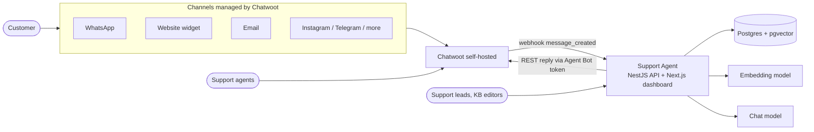
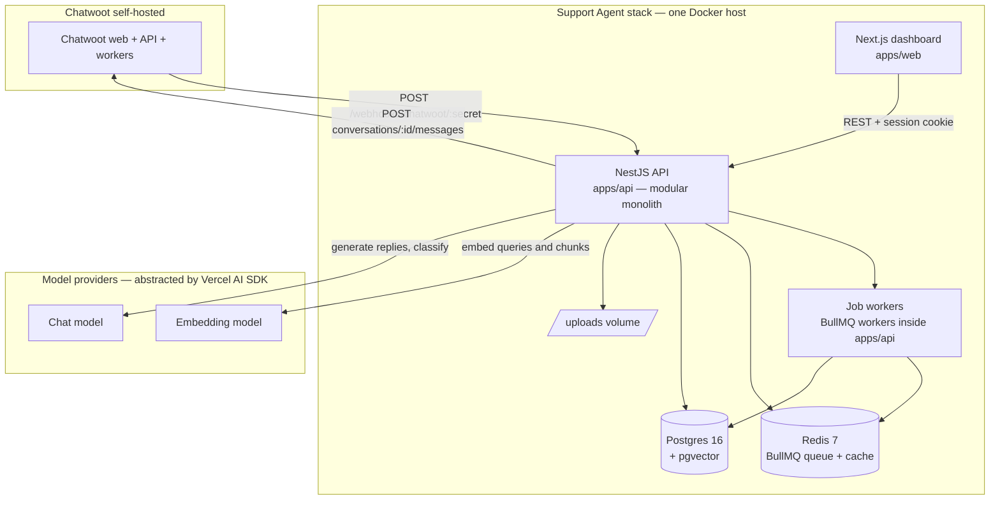

# System Overview

How all the pieces fit together. Details live in the linked docs; this page is the map.

## Context

We integrate with Chatwoot **once**; Chatwoot owns every customer channel. Nothing else in our system talks to WhatsApp/Instagram/etc. directly.

> **Status (2026-10):** the Chatwoot reply pipeline is not implemented yet — the
> webhook stub answers `501` after the secret check. The arrows below show the
> target topology; see [chatwoot doc § Current status](../integrations/chatwoot.md#current-status-2026-10).

## Containers

## Component responsibilities

| Component | Responsibility | Not responsible for |
| --- | --- | --- |
| `apps/web` (Next.js) | Dashboard: login, KB & document management, bindings, playground, analytics, settings | Any business logic — it calls the API |
| `apps/api` (NestJS) | Everything server-side: webhook intake, retrieval, model calls, Chatwoot replies, analytics aggregation | — |
| Job workers (BullMQ in `apps/api`) | Durable background jobs: webhook follow-up, document ingestion, retries; per-conversation ordering lock | Long-term storage (jobs are transient) |
| Postgres + pgvector | All relational data **and** embeddings — single source of truth | — |
| Redis | BullMQ queue + caches (embeddings, retrieval, settings). Ephemeral by design | Long-term storage |
| Uploads volume | Original uploaded documents | Serving files to customers |
| Vercel AI SDK | Single interface to embedding + chat models | Business decisions (thresholds, prompts live in our code) |

## Architecture principles

1. **Modular monolith.** One deployable API with hard module boundaries ([repo structure](repo-structure.md)). Microservices when — and only when — a module genuinely needs its own scaling or failure domain.
2. **Chatwoot is the channel, we are the brain.** All channel complexity belongs to Chatwoot. Our contract with it is one webhook + one REST call, both [documented](../integrations/chatwoot.md).
3. **Postgres for truth, Redis for speed.** All durable state — relational data and vectors — lives in Postgres. Redis holds only ephemeral things: the BullMQ job queue and rebuildable caches ([caching](caching.md)). Nothing that matters survives only in Redis.
4. **Provider-agnostic models.** All model calls go through one module wrapping the [Vercel AI SDK](../integrations/llm-and-vercel-ai-sdk.md). Swapping model — or carrier — is configuration, not code (`LLM_PROVIDER`: OpenAI / OpenRouter).
5. **Grounded or escalate.** The bot answers only from retrieved KB content above a similarity threshold; otherwise it hands off. See [RAG pipeline](rag-pipeline.md).
6. **Human in control.** Kill switches per inbox and per conversation; the bot yields instantly to any human.
7. **Evals before rollouts.** Prompt/KB/model changes ship with an eval run ([roadmap](../product/roadmap.md)).

## Deployment view

Single Docker Compose stack (details + env vars in [deployment](../operations/deployment.md)):

| Service | Image | Notes |
| --- | --- | --- |
| `web` | built from `apps/web` | Next.js server; only exposed to internal network |
| `api` | built from `apps/api` | NestJS; exposes REST + webhook endpoints |
| `postgres` | `pgvector/pgvector:pg16` | single instance, volume-backed |
| `redis` | `redis:7-alpine` | BullMQ queue + cache; AOF on; internal only |
| `proxy` | Caddy (or existing company proxy) | TLS termination for the internal domain |
| Chatwoot | its own existing stack | deployed separately; reachable from `api` |

## Key flows (summary)

| Flow | Trigger | Goes through |
| --- | --- | --- |
| Answer a customer | Chatwoot webhook `message_created` | [Message flow](message-flow.md) |
| Ingest a document | Upload in dashboard → queued job | [RAG pipeline § Ingestion](rag-pipeline.md) |
| Escalate | Low score / customer asks / classifier | [Message flow § Escalation](message-flow.md) |
| Analytics | Dashboard query | [REST API § Analytics](../api/rest-api.md) |

## Scale assumptions

Internal company use: ~5k conversations/month, KBs up to ~50k chunks. This comfortably fits one API instance, one Postgres, and one small Redis on a modest VM. The design leaves seams (queue, retriever interface, storage module) so we can scale pieces independently later without re-architecting.
