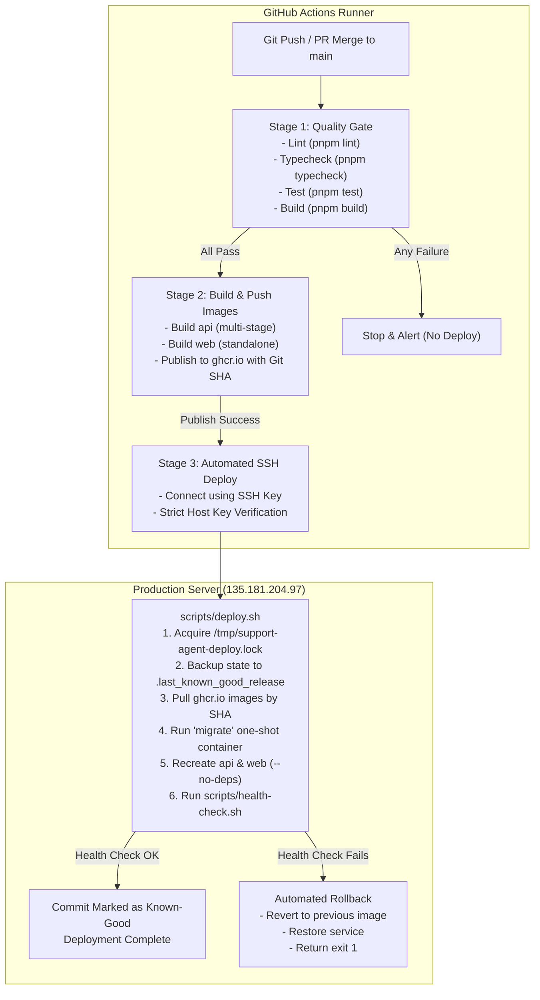

# Production CI/CD Pipeline & Deployment Runbook

## Overview
This document defines the automated, zero-touch Continuous Integration and Continuous Deployment (CI/CD) system for **Support Agent AI**. Every push or merge to the `main` branch automatically triggers quality verification, immutable image creation, publication to GitHub Container Registry (GHCR), database migration execution, and rolling service deployment to the production server behind the host reverse proxy.

---

## 1. Pipeline Architecture



---

## 2. GitHub Secrets & Variables Configuration

To enable the deployment stage in `.github/workflows/deploy-production.yml`, configure the following secrets in **GitHub Repository Settings → Secrets and variables → Actions**:

| Secret / Variable Name | Type | Description | Where to Obtain |
| :--- | :--- | :--- | :--- |
| `SSH_PRIVATE_KEY` | Secret | Dedicated Ed25519 deployment private key | Stored in `/root/.ssh/github_actions_deploy` on the production server. |
| `SSH_KNOWN_HOSTS` | Secret | Production server public SSH host key fingerprint | Generated via `ssh-keyscan -H 135.181.204.97` or read from `/etc/ssh/ssh_host_ed25519_key.pub`. |
| `SERVER_HOST` | Variable / Secret | Production server IPv4 address | `135.181.204.97` (Defaults to this if omitted). |
| `SERVER_USER` | Variable / Secret | Deployment SSH user | `root` (Defaults to this if omitted). |
| `SERVER_PORT` | Variable / Secret | SSH daemon listening port | `22` (Defaults to this if omitted). |

> [!NOTE]
> `GITHUB_TOKEN` is automatically provided by GitHub Actions with `packages: write` permissions to authenticate against GHCR. No manual registry token is required.

---

## 3. Deployment Safety & Invariant Guarantees

### A. Zero Host Port & Reverse Proxy Conflicts
- Routine application deployments do **not** touch or reload the host Nginx configuration.
- Ports `80` and `443` remain owned by the host Nginx.
- Internal loopback bindings (`127.0.0.1:3200` for Web, `127.0.0.1:3201` for API) remain stable across image recreations.

### B. Persistent Database & Cache Isolation
- `postgres` (PostgreSQL 16 + pgvector) and `redis` (Redis 7 with password authentication) run with persistent Docker named volumes (`support-agent_pgdata` and `support-agent_redisdata`).
- Service deployment uses `docker compose up -d --no-deps api web`, ensuring database and cache containers are never restarted or interrupted during normal code releases.

### C. Migration Safety
- Schema migrations use Drizzle ORM forward-only migrations.
- Migrations run in an isolated, one-shot container (`migrate`) **before** new API containers are deployed.
- If a migration fails, the deployment aborts immediately, keeping the current application version active and untouched.

### D. Concurrency Locking
- Deployments are guarded both at the GitHub Actions layer (`concurrency: production-deployment` with `cancel-in-progress: false`) and at the server layer (`flock` on `/tmp/support-agent-deploy.lock`).
- Two workflow runs can never execute deployment scripts concurrently.

---

## 4. Health Verification & Rollback Architecture

### Automatic Verification (`scripts/health-check.sh`)
After container recreation, the health script runs a bounded polling loop (15 attempts, 4s interval) that verifies:
1. Internal backend API responds `HTTP 200` with `status: ok`, `db: ok`, `redis: ok` at `http://127.0.0.1:3201/health`.
2. Internal frontend responds `HTTP 200` or `307` at `http://127.0.0.1:3200`.
3. Public HTTPS endpoint responds `HTTP 200` at `https://support-agent.imtelak.com/health`.
4. Public web UI responds `HTTP 200` or `307` at `https://support-agent.imtelak.com/`.

### Automated Rollback (`scripts/rollback.sh`)
If any health check fails:
1. The deployment script immediately calls `scripts/rollback.sh`.
2. The state file `.last_known_good_release` provides the previous working image and Git SHA.
3. The API and Web services are recreated using the previous known-good images.
4. Health checks are re-evaluated to confirm service restoration.
5. The deployment job exits with code `1`, causing the GitHub Actions run to fail and alert the repository maintainers.

### Manual Emergency Rollback
If you need to manually force a rollback to the previous release on the server:
```bash
cd /root/support-agent
./scripts/rollback.sh
```

To redeploy a specific Git commit SHA directly:
```bash
cd /root/support-agent
IMAGE_TAG="<SPECIFIC_GIT_SHA>" ./scripts/deploy.sh
```
