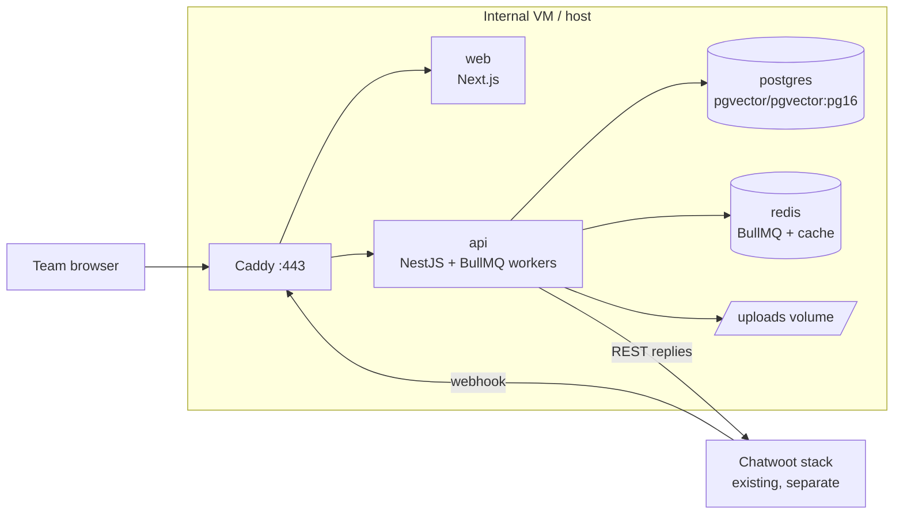

# Deployment

Everything runs in Docker on a single internal host, next to (or near) the existing Chatwoot stack. Target: `docker compose up` on a clean machine gets a working system.

## Services

| Service | Image | Ports | Notes |
| --- | --- | --- | --- |
| `proxy` | `caddy:2` | 80/443 | internal domain TLS; only entry point |
| `web` | built from `apps/web` | internal | Next.js production server |
| `api` | built from `apps/api` | internal | NestJS; runs migrations at start, serves REST + webhook, runs BullMQ workers |
| `postgres` | `pgvector/pgvector:pg16` | internal | volume `pgdata`; extension `vector` enabled by migration |
| `redis` | `redis:7-alpine` | internal | BullMQ queue (db 0) + cache (db 1); AOF on; `maxmemory` capped, `noeviction`; no published ports |

Dev compose (`docker/docker-compose.yml`) is the same minus proxy/TLS, plus hot reload. Prod: `docker/docker-compose.prod.yml` with pinned image digests.

## Resource guide (starting point)

| Service | CPU | RAM |
| --- | --- | --- |
| api (+workers) | 2 vCPU | 2 GB |
| web | 1 vCPU | 512 MB |
| postgres | 2 vCPU | 4 GB (HNSW index fits easily at our scale) |
| redis | 1 vCPU | 512 MB |
| host total | 4 vCPU | 8 GB |

## Environment variables

Validated at boot with zod — the API refuses to start with a bad/missing env (fail fast, not at 3 AM).

| Variable | Example | Notes |
| --- | --- | --- |
| `NODE_ENV` | `production` | |
| `APP_URL` | `https://support-agent.internal.company` | used in cookies/CORS |
| `DATABASE_URL` | `postgres://sa:…@postgres:5432/support_agent` | |
| `REDIS_URL` | `redis://redis:6379` | BullMQ queue (db 0) + cache (db 1) — see [caching](../architecture/caching.md) |
| `AUTH_SESSION_SECRET` | 64-char random | session cookie signing |
| `CHATWOOT_BASE_URL` | `https://chatwoot.internal.company` | |
| `CHATWOOT_ACCOUNT_ID` | `1` | |
| `CHATWOOT_BOT_TOKEN` | `xxxxx` | Agent Bot token |
| `CHATWOOT_WEBHOOK_SECRET` | 48-char random | path segment of our webhook URL |
| `LLM_PROVIDER` | `openai \| anthropic \| self-hosted` | [LLM doc](../integrations/llm-and-vercel-ai-sdk.md) |
| `OPENAI_API_KEY` / `ANTHROPIC_API_KEY` / `SELF_HOSTED_BASE_URL` | — | whichever provider D2 selects |
| `EMBEDDING_MODEL` | `text-embedding-3-small` | must match ingestion (D3) |
| `CHAT_MODEL` | `gpt-4.1-mini` | |
| `UPLOAD_DIR` | `/data/uploads` | mounted volume |
| `LOG_LEVEL` | `info` | |
| `WORKER_CONCURRENCY` | `4` | reply job pool size |

Secrets live in `.env` **only on the host** (or docker secrets) — never in the repo, never in the settings table. `.env.example` in the repo documents names without values.

## Deploy & migrate

1. CI builds `api` + `web` images (tag = git sha), running `pnpm install --frozen-lockfile` + lint/typecheck/tests.
2. On the host: `docker compose -f docker-compose.prod.yml pull && up -d`.
3. Migrations run as a one-shot container (`api migrate`) before the new `api` starts; migrations are forward-only and reviewed like code.
4. Healthcheck `GET /health` gates the rollout; compose restarts unhealthy containers.

No blue/green for MVP (internal tool, tiny user base): a ~10 s gap while `api` restarts is acceptable; Redis AOF keeps queued jobs across restarts.

## Backup & restore

- **Nightly:** `pg_dump` (custom format) + uploads volume `tar` → company backup target. `pgvector` data is inside the dump — nothing special.
- **Restore drill:** once before go-live, then quarterly: restore into a scratch compose stack, run `/health` + one playground query.
- **Retention:** 30 daily + 12 monthly dumps.
- **Redis:** not backed up on purpose — caches rebuild themselves, and queue state is transient (AOF survives container restarts, not disasters). After a full restore, stale jobs are dropped with `FLUSHALL` while the API is stopped.

## Runbooks

### Bot not replying

1. `GET /health` on the api — check the `db` and `redis` fields. Container healthy? If redis is down, see the [Redis runbook](#redis-down-or-full).
2. Chatwoot: is the Agent Bot assigned to the inbox? Inbox binding enabled in dashboard? Global kill switch on?
3. Conversation in Chatwoot: label `ai-paused` or human assignee set?
4. Logs: filter `webhook` request id — did the webhook arrive? Did it pass filters? Any `outcome=error` events?
5. Queue state: BullMQ `waiting/active/failed` counts (logs/metrics) — workers stuck on a slow LLM call? A pile of `failed` replies → inspect the failure reason in the queue.

### Re-ingest a document

Dashboard → KB → document → Reprocess. Behind the scenes: queue job; watch status flip `processing → ready/failed`. If repeated failure: check parse error in `documents.error`; try converting the file to a cleaner PDF/text and upload as a new document.

### Redis down or full

1. Container: `docker compose ps redis` → restart if unhealthy; check logs for OOM or persistence errors.
2. Memory: `INFO memory` — `maxmemory-policy` must be `noeviction`; cache keys all carry TTLs, so usage stays bounded. If it filled up anyway: restart (AOF replays), then raise `maxmemory` (512 MB is generous at our volume).
3. While Redis is down: webhooks answer 503 and Chatwoot retries; dashboards still work (Postgres). After recovery, verify the retried webhooks landed — no duplicate replies (idempotency guards).
4. If pressure keeps recurring: split queue and cache onto separate Redis instances (documented escape hatch in [ADR-0006](../decisions/0006-job-queue.md)).

### Rotate secrets

| Secret | Steps |
| --- | --- |
| `CHATWOOT_BOT_TOKEN` | Create new bot token in Chatwoot → update `.env` on host → restart `api` → verify one answer in a test inbox → delete old token in Chatwoot |
| `AUTH_SESSION_SECRET` | Update + restart; all sessions invalidate (expected; team logs in again) |
| `CHATWOOT_WEBHOOK_SECRET` | Update `.env` → restart → update Agent Bot webhook URL in Chatwoot → send test message |
| Provider API keys | Update at provider → update `.env` → restart → run `GET /settings/health-llm` smoke check |

### Restore from backup

Stop `api`/`web` → restore dump into `postgres` (recreate DB) → restore uploads volume → `FLUSHALL` Redis (drop stale jobs/caches — transient by design) → start `api` (migrations no-op if same version) → run health + playground check → note the restore timestamp for analytics expectations.

## Changing the embedding model (dimension change)

Plan (not an outage-free operation, do during low traffic):

1. Pause the bot globally (kill switch).
2. Add new `embedding_v2 vector(N2)` column via migration; write a backfill script (re-embed all chunks in batches).
3. Flip `EMBEDDING_MODEL`, switch queries to the v2 column in a release.
4. Drop the old column after a week of good answers. Old cache entries are already unreachable (keys include the model id) and expire by TTL — no cache surgery needed.

## Observability & alerting

- **Logs:** pino JSON to stdout → host log driver; request id on every line; webhook id and conversation id on pipeline lines.
- **Metrics (P1):** OpenTelemetry → company Grafana; key panels: webhook rate, filter outcomes, answer latency p50/p95, LLM error rate, queue counts (`waiting/active/failed`), Redis memory, cost/day.
- **Alerts (minimal, from day one via log-based checks):** LLM error rate > 5% (5 min window), webhook 5xx > 3 in 10 min, queue `waiting` > 50 for 10 min, queue `failed` > 5 in 15 min, `/health` failing.

## Environment promotion

`dev` (local compose) → `staging` (same compose, separate Chatwoot test inbox, mock or cheap models) → `prod`. Prompts/thresholds are code + settings; promote via release, never by hand-editing prod DB for anything except the settings UI (audited).
