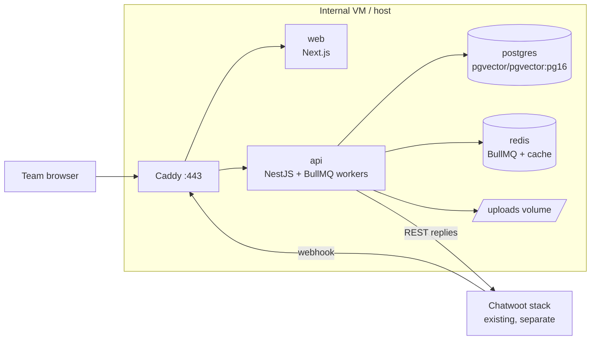

# Deployment

Everything runs in Docker on a single internal host, next to (or near) the existing Chatwoot stack. Target: `docker compose up` on a clean machine gets a working system.

## Services



| Service | Image | Ports | Notes |
| --- | --- | --- | --- |
| `proxy` | `caddy:2` | 80/443 | internal-CA TLS; the only published ports in the stack |
| `web` | built from `apps/web` | internal | Next.js production server |
| `api` | built from `apps/api` | internal | NestJS: REST + webhook + BullMQ workers; starts only after `migrate` exits 0 |
| `migrate` | one-shot of the api image | — | applies the forward-only Drizzle migrations on every deploy |
| `postgres` | `pgvector/pgvector:pg16` | internal | volume `pgdata`; extension `vector` enabled by migration |
| `redis` | `redis:7-alpine` | internal | BullMQ queue (db 0) + cache (db 1); AOF on; `maxmemory` capped, `noeviction`; no published ports |

Dev compose (`docker/docker-compose.yml`) is the same minus proxy/TLS/migrate, plus hot reload. Prod (`docker/docker-compose.prod.yml`) adds Caddy TLS in front, a one-shot `migrate` before `api`, an uploads volume, digest-pinned runtime images, and publishes nothing but 80/443.

## Resource guide (starting point)

| Service | CPU | RAM |
| --- | --- | --- |
| api (+workers) | 2 vCPU | 2 GB |
| web | 1 vCPU | 512 MB |
| postgres | 2 vCPU | 4 GB (HNSW index fits easily at our scale) |
| redis | 1 vCPU | 512 MB |
| host total | 4 vCPU | 8 GB |

## Environment variables

Validated at boot with zod — the API refuses to start with a bad/missing env (fail fast, not at 3 AM). In production it additionally rejects the mock LLM provider, known placeholder secrets, the default company name and default database credentials.

| Variable | Example | Notes |
| --- | --- | --- |
| `NODE_ENV` | `production` | |
| `APP_URL` | `https://support-agent.internal.company` | used in cookies/CORS |
| `DATABASE_URL` | `postgres://sa:…@postgres:5432/support_agent` | |
| `REDIS_PASSWORD` | `openssl rand -hex 32` | required: compose starts Redis with `requirepass`; hex so it is URL-safe |
| `REDIS_URL` | `redis://:<REDIS_PASSWORD>@redis:6379` | BullMQ queue (db 0) + cache (db 1) — see [caching](../architecture/caching.md); keep in sync with `REDIS_PASSWORD` |
| `AUTH_SESSION_SECRET` | 64-char random | required at boot (≥32 chars); placeholder values rejected in production |
| `CHATWOOT_BASE_URL` | `https://chatwoot.internal.company` | |
| `CHATWOOT_ACCOUNT_ID` | `1` | |
| `CHATWOOT_BOT_TOKEN` | `xxxxx` | Agent Bot token |
| `CHATWOOT_WEBHOOK_SECRET` | 48-char random | path segment of our webhook URL; ≥32 chars in production, unset → webhooks 404 |
| `LLM_PROVIDER` | `openai \| openrouter` | `mock` is **dev/test-only** — production refuses to boot in mock mode, no override |
| `OPENAI_API_KEY` | — | chat + embeddings (`openai`); embeddings only under `openrouter` (D3) |
| `OPENROUTER_API_KEY` | — | chat when `LLM_PROVIDER=openrouter` |
| `EMBEDDING_MODEL` | `text-embedding-3-small` | must match ingestion (D3) |
| `CHAT_MODEL` | `gpt-4.1-mini` | |
| `COMPANY_NAME` | `Acme Support` | fills `{{company_name}}` in the answer prompt; required in production (the default is rejected) |
| `DIGEST_WEBHOOK_URL` | `https://hooks.slack.com/services/…` | weekly top-unanswered digest target (see below); Slack-compatible `{"text": …}`; unset → logged only |
| `RETENTION_DAYS` | `365` | messages/events retention window in days (NFR-7); documents/KBs are never purged |
| `ALERT_WEBHOOK_URL` | `https://hooks.slack.com/services/…` | ops channel for threshold alerts (see below); Slack-compatible `{"text": …}`; unset → `warn` log lines |
| `ALERT_COOLDOWN_MINUTES` | `30` | re-alert suppression window per condition |
| `ALERT_REDIS_MEMORY_MB` | `460` | Redis memory alert cap when `maxmemory` is unset (512 MB box, ADR-0006) |
| `UPLOAD_DIR` | `/data/uploads` | mounted volume |
| `LOG_LEVEL` | `info` | |
| `WORKER_CONCURRENCY` | `4` | reply job pool size |

Secrets live in `.env` **only on the host** (or docker secrets) — never in the repo, never in the settings table. The `.env.example` files carry development-only placeholders (dev webhook secret, `mock` provider, `Acme Support`); production rejects known placeholder values at boot.

Compose-level values live in the same repo-root `.env` (template: `docker/.env.prod.example`): `POSTGRES_USER` / `POSTGRES_PASSWORD` / `POSTGRES_DB`, `SITE_ADDRESS` (the Caddy site address + TLS certificate name) and `NEXT_PUBLIC_API_URL` (public dashboard origin, baked into the web build — rebuilding `web` is required when it changes).

## Scheduled jobs

No host cron needed: the API schedules its own repeatable jobs on Redis (BullMQ).
The weekly top-unanswered digest is upserted at every boot as a job scheduler —
Mondays 09:00 UTC on the `analytics-followup` queue — and posts the trailing week's
clustered questions to `DIGEST_WEBHOOK_URL` (Slack-compatible; retried 3× with
backoff, failed runs stay inspectable on the queue). Without the webhook the digest
is written to the API log instead.

The daily retention cleanup is scheduled the same way — 03:00 UTC on the
`maintenance` queue. It deletes messages/conversations and answer/audit events older
than `RETENTION_DAYS` (default 365, NFR-7) in 1,000-row batches, so a backlog never
holds one huge transaction; documents, chunks, KBs, users and settings are never
touched. The next morning, check the `retention done: cutoff=… deleted=…` log line
for the per-table counts.

The `alert-check` job runs every 5 minutes on the same queue — see
[Observability & alerting](#observability--alerting) for the thresholds and the
ops-channel wiring.

## Deploy & migrate

One compose file, one API image: the image also carries the one-shot `migrate` command, so schema and code always deploy together. CI builds both images on every change (the Dockerfiles must keep building); images are built on the host for now — a registry push is a later hardening step.

**Clean host:**

1. Install Docker + compose; clone the repo.
2. `cp docker/.env.prod.example .env` and fill in the secrets (see § Environment variables).
3. Build and start the whole stack:

   ```sh
   docker compose --env-file .env -f docker/docker-compose.prod.yml up -d --build
   ```

   Compose runs the pending Drizzle migrations in the one-shot `migrate` service first; `api` starts only after it exits 0 (forward-only migrations, reviewed like code). The `api` healthcheck gates `web` and `proxy`.
4. Create the first admin (a random password is printed once):

   ```sh
   docker compose --env-file .env -f docker/docker-compose.prod.yml \
     run --rm api node dist/cli/seed-admin.js --email admin@company.com
   ```

5. Trust the internal CA (Caddy issues the certificate for `SITE_ADDRESS`):

   ```sh
   docker compose --env-file .env -f docker/docker-compose.prod.yml \
     exec proxy cat /data/caddy/pki/authorities/local/root.crt > caddy-root.crt
   ```

   Install `caddy-root.crt` on team machines — or point `docker/Caddyfile` at real certificates (`tls /certs/…`) / a public domain and drop `tls internal`.
6. Verify: `curl -k https://$SITE_ADDRESS/health` → `{"status":"ok",…}`; log in at `https://$SITE_ADDRESS/login`.

**Updates:** `git pull`, then the same `up -d --build` command: a fresh `migrate` runs first, `api` restarts after it, and web/proxy are recreated only when their inputs changed. Changing `SITE_ADDRESS` or `NEXT_PUBLIC_API_URL` requires a `web` rebuild (the API origin is baked into the Next build) — the same command covers it.

No blue/green for MVP (internal tool, tiny user base): a ~10 s gap while `api` restarts is acceptable; Redis AOF keeps queued jobs across restarts.

## Backup & restore

**Nightly** (host cron or backup agent) — run from the repo root, send both files to the company backup target:

```sh
docker compose --env-file .env -f docker/docker-compose.prod.yml exec -T postgres \
  pg_dump -U sa -d support_agent -Fc > support-agent-$(date +%F).dump

docker run --rm -v support-agent_uploads:/data:ro -v "$PWD":/backup alpine \
  tar czf /backup/support-agent-uploads-$(date +%F).tgz -C /data .
```

`pgvector` data is inside the dump — nothing special. Retention: 30 daily + 12 monthly dumps. **Redis is not backed up on purpose** — caches rebuild themselves and queue state is transient (AOF survives container restarts, not disasters).

**Restore drill:** before go-live, then quarterly — load the newest dump + uploads tar into a scratch stack (same compose file, a different project name, on a spare host or with the prod stack stopped so ports are free) following § Restore from backup, and end with `/health` + one playground query.

## Runbooks

### Bot not replying

1. `GET /health` on the api — check the `db` and `redis` fields. Container healthy? If redis is down, see the [Redis runbook](#redis-down-or-full).
2. Chatwoot: is the Agent Bot assigned to the inbox? Inbox binding enabled in dashboard? Global kill switch on?
3. Conversation in Chatwoot: label `ai-paused` or human assignee set?
4. Logs: filter `webhook` request id — did the webhook arrive? Did it pass filters? Any `outcome=error` events?
5. Queue state: BullMQ `waiting/active/failed` counts (logs/metrics) — workers stuck on a slow LLM call? A pile of `failed` replies → inspect the failure reason in the queue.

### Re-ingest a document

Dashboard → KB → document → Reprocess. Behind the scenes: queue job; watch status flip `processing → ready/failed`. If repeated failure: check parse error in `documents.error`; try converting the file to a cleaner PDF/text and upload as a new document.

### Redis down or full

1. Container: `docker compose ps redis` → restart if unhealthy; check logs for OOM or persistence errors.
2. Memory: `INFO memory` — `maxmemory-policy` must be `noeviction`; cache keys all carry TTLs, so usage stays bounded. If it filled up anyway: restart (AOF replays), then raise `maxmemory` (512 MB is generous at our volume).
3. While Redis is down: webhooks answer 500 and Chatwoot retries; dashboards still work (Postgres). After recovery, verify the retried webhooks landed — no duplicate replies (idempotency guards).
4. If pressure keeps recurring: split queue and cache onto separate Redis instances (documented escape hatch in [ADR-0006](../decisions/0006-job-queue.md)).

### Rotate secrets

Every rotation = edit `.env` on the host → recreate only the API:

```sh
docker compose --env-file .env -f docker/docker-compose.prod.yml up -d api
```

| Secret | Steps |
| --- | --- |
| `CHATWOOT_BOT_TOKEN` | Create a new bot token in Chatwoot → `.env` → recreate `api` → verify one answer in a test inbox → delete the old token |
| `AUTH_SESSION_SECRET` | `.env` → recreate `api`. It is validated at boot but does not sign cookies yet, so live sessions are unaffected — to force a global sign-out, delete the session rows: `… exec -T postgres psql -U sa -d support_agent -c 'delete from sessions'` (all cookies answer 401; the team logs in again) |
| `CHATWOOT_WEBHOOK_SECRET` | `.env` → recreate `api` → update the Agent Bot webhook URL in Chatwoot; the old path answers 404 until then. While the pipeline is a stub (T-201) the correct path answers 501 — a 200/anything else means Chatwoot still points at the old secret |
| Provider API keys | Rotate at the provider → `.env` → recreate `api` → run the `GET /settings/health-llm` smoke check (Settings screen) |
| `REDIS_PASSWORD` | `.env` (both `REDIS_PASSWORD` and the `REDIS_URL` copy) → `… up -d redis api web proxy`. Queue and cache are transient by design, so a restart is the whole migration |

### Restore from backup

Run from the repo root with the dump + uploads tarball in `$PWD`:

1. Stop the app tier: `docker compose --env-file .env -f docker/docker-compose.prod.yml stop api web proxy`
2. `… up -d postgres redis`
3. Recreate the database and load the dump:

   ```sh
   … exec -T postgres dropdb -U sa --if-exists support_agent
   … exec -T postgres createdb -U sa support_agent
   … exec -T postgres pg_restore -U sa -d support_agent --no-owner --exit-on-error < support-agent-2026-10-18.dump
   ```

4. Restore uploads (`chown` restores the app user's ownership — the API runs as `node`, uid 1000; without it the volume is left root-owned and new uploads fail):

   ```sh
   docker run --rm -v support-agent_uploads:/data -v "$PWD":/backup alpine \
     sh -c 'find /data -mindepth 1 -delete && tar xzf /backup/support-agent-uploads-2026-10-18.tgz -C /data && chown -R 1000:1000 /data'
   ```

5. Drop stale queue state + caches (transient by design): `… exec -T redis sh -c 'REDISCLI_AUTH=$REDIS_PASSWORD redis-cli FLUSHALL'`
6. Start everything: `… up -d` — `migrate` no-ops on the restored schema, then api/web/proxy come back.
7. Verify `/health`, log in, one playground query; note the restore timestamp for analytics expectations.

(Earlier steps abbreviate the compose invocation; it is `docker compose --env-file .env -f docker/docker-compose.prod.yml` throughout.)

## Load smoke (NFR-1/2/8)

`scripts/load-smoke.ts` is the repeatable burst check — run it from the repo root against dev, staging or prod:

```sh
pnpm --filter api load:smoke -- \
  --base-url https://support-agent.internal.company --insecure \
  --email ops@company.com --password '<admin password>' \
  --webhook-secret '<CHATWOOT_WEBHOOK_SECRET>'
```

- **Webhook ack** (NFR-1): `--webhook-burst` (default 100) synthetic `message_created` events at `--concurrency` (default 20 — the NFR-8 burst envelope; the 5k conversations/month average is ~7/h). Asserts the documented status — 501 while the pipeline is a stub (T-201), 2xx afterwards — and ack p95 ≤ 300 ms after a 10-request warm-up. Against non-local targets the script checks the inbox's bindings and **refuses an enabled (bound) inbox** (or anything unverifiable) — synthetic events would become real conversations once T-201 lands; `--allow-live-burst` is the deliberate override.
- **Pipeline latency** (NFR-1): `--pipeline-count` (default 20) playground asks at the same concurrency through the full answer path, against a throwaway KB (`--kb <uuid>` reuses a populated one; KB create/delete needs an admin account). Asserts p95 end-to-end ≤ 15 s and retrieval p95 ≤ 500 ms. Numbers are only meaningful with a real provider key — under `LLM_PROVIDER=mock` it is a plumbing check — and the customer-message → posted-reply path joins the measurement with T-203.
- **Queue durability** (NFR-2): `--jobs` (default 50) jobs on the dedicated `load-smoke` queue with the ADR-0006 defaults; Redis is restarted mid-flight (`--restart-cmd` overrides the default dev-compose command, `--skip-restart` for managed Redis), then nothing may be lost and every job must complete. The dedicated queue name means a prod run never touches real reply traffic.

Exit code is non-zero when any assertion fails. The burst is side-effect-free until the reply pipeline lands (T-201+); afterwards point `--account`/`--inbox` at a test inbox or run the burst in staging.

## Changing the embedding model (dimension change)

Plan (not an outage-free operation, do during low traffic):

1. Pause the bot globally (kill switch).
2. Add new `embedding_v2 vector(N2)` column via migration; write a backfill script (re-embed all chunks in batches).
3. Flip `EMBEDDING_MODEL`, switch queries to the v2 column in a release.
4. Drop the old column after a week of good answers. Old cache entries are already unreachable (keys include the model id) and expire by TTL — no cache surgery needed.

## Observability & alerting

- **Logs:** pino JSON to stdout → host log driver; request id on every line; webhook id and conversation id on pipeline lines.
- **Metrics (P1):** OpenTelemetry → company Grafana; key panels: webhook rate, filter outcomes, answer latency p50/p95, LLM error rate, queue counts (`waiting/active/failed`), Redis memory, cost/day.
- **In-app alerts (from day one):** an `alert-check` job runs every 5 minutes on the `maintenance` queue and evaluates: LLM error rate > 5% (5 min window, ≥ 5 calls), webhook 5xx > 3 in 10 min, queue `waiting` > 50, oldest waiting job > 10 min, queue `failed` > 5 in 15 min, and Redis memory > 90% of `maxmemory` (or above `ALERT_REDIS_MEMORY_MB` when unset). Breaches post a Slack-compatible `{"text": …}` message to `ALERT_WEBHOOK_URL` (unset → `warn` log lines) and repeat at most once per `ALERT_COOLDOWN_MINUTES` per condition. `/health` still needs an external uptime check — a dead API cannot alert about itself.

## Environment promotion

`dev` (local compose) → `staging` (same compose, separate Chatwoot test inbox, mock or cheap models) → `prod`. Prompts/thresholds are code + settings; promote via release, never by hand-editing prod DB for anything except the settings UI (audited).
